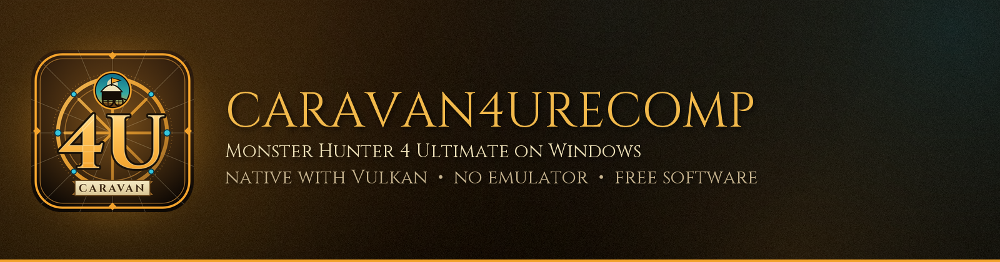
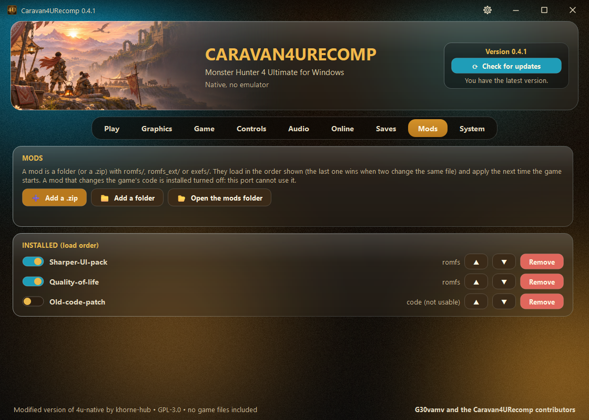
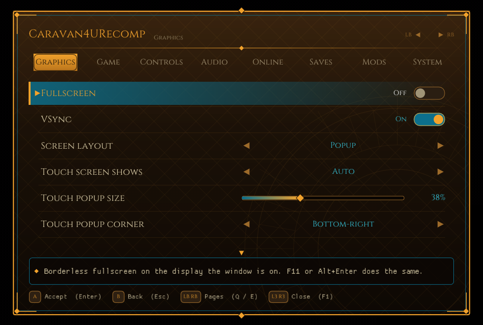

<p align="center"></p>

# Caravan4URecomp

**Monster Hunter 4 Ultimate on Windows, running natively through Vulkan.**

Caravan4URecomp is my Windows port of [4u-native](https://github.com/khorne-hub/4u-native) by khorne-hub. It is a **modified
version**: it is not the official 4u-native, and it is not made or endorsed by khorne-hub. All the hard work (the
recompiler, the runtime and the original app) is theirs and CompaLarios18's, and I'm very grateful for it. What I added is
a Windows shell around that runtime, a launcher, and my own code for a large part of what the runtime did with code
derived from Azahar.

[Leer en español](#español)

**This project includes no game code, game files, ROMs or keys. You need your own copy of the game.**

<p align="center">
  
  
</p>

## What's new in 0.5.0

This one collects everything I did since 0.4.3.

- **One screen.** The touch screen's menus can be drawn on the top screen, so you can play with a single picture. The arrangement is based on Heavenfall's single-screen mod (see [Credits](#credits)); I adapted it to this port and fixed what flickered in it. The 16:9 option makes the top screen use the whole window instead of leaving black bars.
- **The world map on the main screen.** In a village, **M** on the keyboard or **Start** on a controller opens the map (the PlayStation touchpad click works too if you pick it), and **M** or the same button closes it. With the map open, **Y** (the North button; the triangle on a PlayStation controller) or **N** presses *Solo / multiplayer*, which is drawn under the map with a small hint. The keys and buttons can be changed in the launcher (Controls); an `.ini` from an older version keeps working, it just uses these defaults.
- **A smaller hunting HUD.** One size for all of it and one for each part (clock, bars, sharpness, party, map, target camera, item bar), in the in-game menu and the launcher.
- **More graphics options:** antialiasing, bloom, motion blur, depth of field, radial blur, haze, dither and field of view.
- **Comforts and cheats, all off by default.** Hold A to gather, cancel the pose after a drink, cancel sharpening, rewards without limit, send all rewards to the box; and, at your own risk, *Invincible* and *Infinite items*. The cheats write to the game's memory, so they can break an online hunt or a save. Some comforts follow the ideas of jM5557's MH4U QOL mods (see [Credits](#credits)).
- **Controls:** a button for the kick, one for the target camera, and buttons held together to end the wait after a quest (ZL + ZR by default). The skip button can now be Start, Back or the PlayStation touchpad, and pressing it in the village no longer opens the game's menu.
- **The monster life bar** has a smaller plate, and the in-game menu's list scrolls one row per notch of the mouse wheel.
- **I removed FSR.** It was optional and off by default, but on the GPUs where people tried it (AMD and NVIDIA) it cost frames instead of giving them. The `upscaler` and `fsr_quality` lines of an old `.ini` are simply ignored.
- **Online:** more detail in the log of rooms (times, statistics, why a connection dropped) to find why some players leave at the start of a quest.

What I haven't tested: the vote to end the wait online (it needs two players with this version), controllers other than a DualSense and a GameSir, and Windows 10. One thing I already know: the launcher flickers when the game closes; I'll look into it.

## What's new in 0.4.1

A small update on top of 0.4.0:

- **AMD FSR 1.0 (optional, off by default; removed in 0.5.0).** The game is drawn at a lower internal resolution and brought up to your window's size with AMD's FidelityFX Super Resolution 1.0 (upscaling and sharpening). Turn it on in the in-game menu (Graphics) or in the launcher; the *FSR quality* option picks how much lower the internal resolution is when the resolution is on auto. I'm being honest about it: on my RTX 4070 it did not raise the frame rate (the game's CPU thread is the limit there), and in my own play it even cost a few frames, so it is for you to test. It is meant for weaker GPUs.
- **HD texture size limit (optional).** A texture of an HD pack larger than the limit you choose (4096, 2048, 1024 or 512 pixels on its longer side) is reduced before it is loaded, so it takes less video memory and loads faster, with less detail. With my pack a limit of 1024 cut the textures from 440 to 277 MB. Off by default.
- **A new header for the launcher**, with art made for the port.
- Discord Rich Presence is confirmed to work on a real Discord.

## What's new in 0.4.0

This is a big one: it collects everything I did since 0.3.1.

- **A launcher** (`Caravan4URecomp-Launcher.exe`). It opens before the game, lets you change every option of the in-game menu and also the ones that only apply when the game starts (internal resolution, HD textures, the render thread...), manages your mods and shows your saves and the game's log. It updates the program by itself, downloading only the files that changed instead of the whole zip. See [The launcher](#the-launcher).
- **The cutscene skip works.** Tab skips the cutscene when you eat and the one after a monster dies (it taps the Skip button of the touch screen). You can choose the key and a controller button in the launcher or in the in-game menu (Controls), and the button you choose keeps doing what it does in the game.
- **Music no longer drags in the village.** The sound could lose a few percent of its frames when the game was busy, which made the music slow and uneven and the audio stutter. The audio now catches up and has a larger safety buffer.
- **The frame counter shows the frames the game really runs.** With a 30 fps limit it shows 30 (before it counted screen refreshes, so it said 60).
- **Two new screen layouts:** *large* (a big top screen with the small touch screen beside it) and a real *overlay* (the touch screen always over the picture). The old "overlay" with no size drew two fixed-size screens in a corner.
- **More of the runtime is my own code.** The kernel, many services, the DSP and the renderer's main parts now have independent implementations that I checked against the previous behaviour (traces, audio comparisons, screenshots). The online part still uses Azahar's room protocol on purpose, so rooms stay compatible.
- **An optional render thread** (`gpu_thread` in the ini, or in the launcher) that sends the drawing to its own thread.
- **Controllers:** my own reader for DualSense, DualShock 4 and generic HID pads (only used when nothing else sees the controller), and an offer to add the program to HidHide's list if it is hiding your PlayStation controller.
- **Smaller things:** `F8` (or Share + R3) puts a time mark in the log, to find what happened when you noticed a problem; Discord Rich Presence (off with `discord_presence = off`); `hd_textures = off` to skip the texture pack; a tidier `.ini`; and a fix for the controller's duplicated presses in the menu.

## Status

I'd rather be upfront about what I have actually tested.

**Working (tested on Windows 11, NVIDIA RTX 4070, mostly with the USA version v1.3.0):**
- The game boots and runs; character creation, quests and complete hunts, without crashes. In the village with HD textures at 6x it runs at about 90 to 115 fps; in cutscenes it reaches my display's 165.
- Keyboard, mouse (as the stylus of the touch screen) and controller, including a DualSense over Bluetooth and typing a hunter's name with a controller.
- Windowed and fullscreen (F11 or Alt+Enter), resizing, and an internal resolution of 1x to 8x.
- The skip button for the cutscene of eating and the one after killing a monster.
- The in-game menu and the launcher: I checked each page, changed options and saw them applied.
- Network rooms that speak the same protocol as Azahar's: I joined a real public room from the menu while the game was running, and I played Local Play in a Gathering Hall with another player.
- Saves backups, mods listed, turned on and off and ordered from the launcher, and Discord Rich Presence on a real Discord.

**Not tested yet:**
- The **update system of the launcher** against a real release: 0.4.0 is the first one that has it, so there is nothing newer to update to yet. It has been tested with local files.
- The launcher on other PCs and on Windows 10, and with other languages than English and Spanish.
- The new controller reader with real controllers (a DualSense over Bluetooth works through the usual path), and the HidHide offer.
- What the game's CPU thread costs in the village: the game runs at about 100 to 115 fps there whatever the resolution, and I plan to look into it.
- The skip button in cutscenes other than the two above, and the mouse as the camera (**F3**, or `mouse_camera = on`).
- Resolutions of 9x and 10x: the picture still comes out black there.
- Other GPUs and drivers, building with MSVC (I build with clang from llvm-mingw), and Windows and Android crossplay.
- A few moments still stutter a little (the roar of some monsters, and very high frame-rate limits); I'm looking into them.

## Getting it

The releases are on the [Releases](https://github.com/G30vamv/Caravan4URecomp/releases) page; the latest is **0.5.0**, tagged `windows-v0.5.0`. This port has its
own version numbers, following [semantic versioning](https://semver.org) (while the number starts with 0, anything can still
change), and they are tagged `windows-vX.Y.Z` so they don't mix with the older tags in this repository (`v0.1.0` to `v1.0`),
which are 4u-native's own. Each download has its SHA-256 next to it. The program is not code-signed, so Windows may show a
SmartScreen warning: "More info", then "Run anyway". You can also build it yourself (see [Building](#building)).

## What you need

- Windows 10 or 11, 64-bit, and a GPU with Vulkan 1.2 or newer.
- About 1 GB of free space while the game is prepared (afterwards it takes about 350 MB: the game's code library and the part of the compiler that was downloaded).
- **Your own decrypted copy of Monster Hunter 4 Ultimate (USA):** the base game and the **v1.3.0 update**.

## First start

Unzip everything in a folder you can write to, and open `Caravan4URecomp-Launcher.exe` (or `Caravan4URecomp.exe` directly:
it works the same). The first time you press Play, the game asks for the two game files and builds the game's code library for
your PC, which takes a few minutes and downloads only the part of a compiler that it needs (about 50 MB; each file is checked
against its SHA-256). After that the game starts straight away. `--setup` (or the button in the launcher) repeats this step if
you change files. What it builds is made from your game: keep it for yourself and don't share it.

## The launcher

`Caravan4URecomp-Launcher.exe` sits next to the program and edits `Caravan4URecomp.ini`, the same file the in-game menu uses.
Everything is saved as soon as you change it.

- **Play:** a summary of your settings, the Play button, quick actions and the last lines of the game's log.
- **Graphics, Game, Controls, Audio, Online, Saves, System:** every option of the in-game menu, and the ones that only apply
  when the game starts (the game is closed while the launcher is open, so it can always change them). Hover an option for
  its explanation.
- **Mods:** add a mod as a `.zip` or a folder, turn mods on and off, change their order and remove them. A mod that changes the
  game's files works; a mod that changes its code is installed turned off, because the game's library is built without it.
- **Saves:** opens your saves, your guild cards and quests, and the automatic backups.
- **Updates:** it looks for a new version when it opens (you can turn that off in the gear menu) and, if you accept, downloads
  only the files that changed, checks each one against its SHA-256, replaces them and opens again. Your settings, your saves
  and your game folder are never touched, and the files it replaces are kept in a backup folder next to the program.
- The gear menu has the launcher's own options: its language (English or Spanish), animations, the Acrylic effect of Windows 11
  and whether it minimizes while you play.

<p align="center"></p>

The launcher is Python (PySide6) code adapted from the launcher of my MH3U port, in this project's colours. You can build it with
`windows\launcher\build_launcher.ps1` (it needs Python with PySide6-Essentials, Pillow and PyInstaller).

## Controls

Keyboard: F = A, Space = B, V = X, E = Y, Enter = Start, Backspace = Select, arrows = D-pad, W A S D = left stick,
O L K ; = right stick, Q = ZL, C = ZR, left Ctrl = L, left Shift = R, Tab = skip a cutscene. The mouse is the stylus on
the bottom screen. A controller works as it is. Every button can be changed in the launcher or in the in-game menu.

### In-game menu

Press **F1** or **L3 + R3** on a controller. It works with the keyboard, the mouse (click, drag the sliders, wheel,
right click to go back) and the controller (D-pad or left stick, A and B; LB and RB, or Q and E, change the page). The
design comes from the menu of my MH3U port, with this game's colours, in the Cinzel font (SIL Open Font License).

<p align="center">
  
  
</p>

- **Graphics:** fullscreen, VSync, screen layout, picture shape (the 3DS's own 5:3 with bars on a wide screen, stretched to fill the window, or a fixed ratio), internal resolution (auto, or 1x to 8x the 3DS's; needs a restart), FPS counter.
- **Game:** frame rate limit (the game's own, your display's rate, 30, 60, 120, 180, 240, 300, 360 or unlimited), steady
  frame rate, particle effects.
- **Audio:** volume.
- **Controls:** the key and the controller's button that skip a cutscene, and every 3DS button with its key and its controller button. Press Enter on one, then the key or the controller's button or trigger you want (Backspace puts it back). The sticks and F1, F2, F3 and F11 stay as they are.
- **Saves:** backups of your saves. One is made by hand, or automatically each time the game starts if the saves changed (the newest 5 automatic ones are kept). Enter twice on a backup puts it back the next time the game starts, after a backup of what was there.
- **Mods:** drop a mod's folder or .zip on the window to install it, turn mods on and off and set their order (they apply the next time the game starts). Mods that change the game's files work; mods that change its code are installed turned off, because the game's library is built without them.
- **System:** the language of the menu (English or Spanish; "auto" follows Windows), resume and quit.
- **Online:** nickname, host a room, join with the copied address, public rooms, join by address, leave.

The default screen layout is the **popup** one: the top screen fills the window and the touch screen appears over it, only when
the game is waiting for you there; **F2** shows or hides it by hand, and the menu lets you choose when it shows (auto, always,
hidden), its size and its corner. The other layouts are **stacked**, **overlay** (the touch screen always over the picture),
**single**, **side** and **large** (a big top screen with a small touch screen at its right). Every change is saved to
`Caravan4URecomp.ini` as soon as you make it. A few settings (the internal resolution, HD textures, the render thread and going
back to "default" in the game options) only apply the next time the game starts: the menu saves them, says so, and lists them
until you close the game; it never restarts anything by itself. **Graphics > Open the HD textures folder** opens the folder for
texture packs.

## Frame rate, resolution and sound

- **Frame rate:** the limit goes up to 360 fps. The counter shows the frames the game really runs (with a 30 fps limit, 30), which
  can be lower than the screen's refresh. With VSync on you can see at most your display's refresh rate, so "display" in the
  limit setting is the natural choice. If it feels uneven at a high refresh rate, lower the internal resolution. Each frame the
  game shows is read back from the GPU, so the highest rate depends on the internal resolution: about 580 fps at 3x, 160 at 6x and
  97 at 8x. In a busy scene (the village with HD textures at 6x on my PC) the game runs at about 90 to 115 fps whatever the limit.
- **Internal resolution (1x to 8x):** everything the GPU draws (the 3D scene, the HUD and the text) is rendered at that multiple
  of the 3DS's resolution; "auto" picks the one closest to your window. The game's own textures stay at their original
  resolution, so edges get sharper but not more detailed. HD texture packs made for Azahar and Citra (PNG, their folder
  layout and hashes) are supported by the runtime: put them under `game\user\load\textures`. At 9x and 10x the picture
  is still black on my card, so the menu stops at 8x.
- **Picture shape:** the 3DS's top screen is 5:3, so on a 16:9 screen there are black bars at the sides. **Graphics > Picture
  shape > stretch** fills the whole window (the picture is stretched a little); the fixed ratios are there too.
- **The HD texture limit:** see [What's new in 0.4.1](#whats-new-in-041) (FSR, described there, was removed in 0.5.0).
- **Sound:** the audio buffer is 60 ms by default; `options = --audio-latency 100` in the ini makes it larger if you hear cuts.

## Playing online

The rooms are the same kind Azahar uses, so players on this port, on Azahar and on 4u-native for Android can share a
room. Everyone needs MH4U USA v1.3.0.

1. Open the menu (or the launcher's Online page), and choose a nickname.
2. To **host**: choose **Host a room**. The program looks for a Radmin VPN, Hamachi, ZeroTier or Tailscale address on your PC
   (with one of those there is no router to open) and otherwise for your local network's, and **copies the address with
   its port** (for example `26.1.2.3:24872`) to the clipboard. Send it to your friends. Without a VPN you need the UDP port (24872 by default) open on your router.
3. To **join** a friend: copy the address they sent and choose **Join with the copied address**. Or **Public rooms** lists the
   rooms of the community lobby (a `*` marks the ones set up for MH4U), or type a `HOST:PORT` address by hand. If you write no port, 24872 is used.
4. Being in the room is not enough: in the game, go to the **Gathering Hall** and choose **Local Play**. While you are in a
   room the touch screen stays up in towns (`online_touch = off` in the ini turns that off).

From the command line: `--list-rooms [URL]`, `--join HOST:PORT`, `--host PORT`, `--nick NAME`, `--room-password TEXT`.
The lobby is read over plain HTTP, like Azahar does. Hosted rooms are not announced to the lobby, so people find your room
by its address, not in Azahar's list.

## Building

You need CMake, Ninja, [llvm-mingw](https://github.com/mstorsjo/llvm-mingw) (UCRT, x86_64) and Python 3.10 or newer. In a
PowerShell window:

```
powershell -ExecutionPolicy Bypass -File windows\build.ps1 [-Launcher]
powershell -ExecutionPolicy Bypass -File windows\package.ps1 -Version 0.5.0
```

`build.ps1` downloads SDL3 and builds the program (with `-Launcher` it builds the launcher too); `package.ps1` makes the zip.
The game's code library is built on each player's PC from their own files, and it is never part of this repository.

## What I changed in 4u-native

- New: the `windows/` folder (the Windows shell, the in-game menu, the launcher in `windows/launcher/`, the build and packaging scripts).
- New: `mh4n/native/own/`, my own implementations of services and of the DSP (apt, cfg, ptm, fs, ir, y2r, small services, the DSP core and its service), and in `mh4n/native/src/` the new parts of the kernel, the renderer and the loader that replace code derived from Azahar. The previous implementations stay in the source tree (the tests still use them).
- New: `mh4n/native/src/applets/extrapad.{h,cpp}`, a minimal Extrapad applet so the Circle Pad Pro option in the game's
  settings doesn't close the game.
- Changed: `mh4n/port/src/hooks.cpp` and `hooks.h` (a counter of the objects the game draws on the touch screen, the skip button, the frame counter and the frame limiter's own numbers).
- Changed: `mh4n/native/src/gpu/native/native_gpu.cpp` and the files around it (the renderer uses the Vulkan device the window shell already has, and the
  screen is read out without a one-pixel shift that Azahar's software renderer has and that drew a wrong line along the top
  of the picture).
- Changed: `mh4n/native/src/screen_layout/` (the *large* layout and the fixed overlay) and `mh4n/native/app/audio/`, `mh4n/native/src/audio_out/` (the audio buffer and its diagnostics).
- Changed: `mh4n/port/src/onescreen_table.h` (a generated table, edited by hand: the Gathering Hall's player list stays on
  the touch screen instead of covering the top one), `mh4n/native/src/services/apt/applet_manager.cpp` and `mh4n/native/src/applets/CMakeLists.txt`.

Every changed file says so in its header. The Android app is untouched.

## Credits

- The recompiler and the native runtime: [MH4UltimateDC](https://github.com/CompaLarios18/MH4UltimateDC) by CompaLarios18
  and its contributors.
- 4u-native, the Android app this port is based on: [khorne-hub](https://github.com/khorne-hub/4u-native).
- Parts of the runtime come from [Azahar](https://github.com/azahar-emu/azahar) and Citra.
- The single-screen arrangement of the touch screen's menus is based on [Heavenfall Beta](https://github.com/popzol/4u-heavenfall-mod-beta) by popzol and BlitzWOLF (GPL-3.0), taken at commit `7eebb7a`, without its gameplay changes.
- Some of the comforts follow the ideas of [MH4U-QOL-Cheats](https://github.com/jM5557/MH4U-QOL-Cheats) by jM5557 (I wrote them again for this port).
- The upscaler that was optional until 0.4.3 was AMD's [FidelityFX Super Resolution 1.0](https://github.com/GPUOpen-Effects/FidelityFX-FSR) (MIT license); it is no longer used.
- The libraries used, with their licenses, are listed in `THIRD_PARTY_NOTICES` and `windows/THIRD_PARTY_NOTICES_WINDOWS`.
- The full credits of 4u-native are in its [README](../README.md), which is kept as it was.

## License

Free software under the [GNU General Public License, version 3](../LICENSE) or (at your option) any later version. The code
by khorne-hub carries [additional terms](../ADDITIONAL-TERMS), which still apply: keep the author's credits, mark a changed
version as changed and don't present it as the official one, and give the license and the complete source code with
every copy of the program. New code of this port: Copyright (C) 2026 G30vamv and the Caravan4URecomp contributors. The launcher's
Python code is mine, under the GNU Affero General Public License v3, and it bundles PySide6 (LGPL-3.0), Pillow and PyInstaller
(see `windows/THIRD_PARTY_NOTICES_WINDOWS`).

This project is not affiliated with, endorsed by or sponsored by the Great C or the Great N. Monster Hunter is a trademark
of the Great C. The 3DS is a trademark of the Great N. It contains no game code, game data, ROMs or keys. Use it only with
a copy of the game you own.

---

## Español

**Monster Hunter 4 Ultimate en Windows, nativo y con Vulkan.**

Caravan4URecomp es mi port para Windows de [4u-native](https://github.com/khorne-hub/4u-native), de khorne-hub. Es una
**versión modificada**: no es la oficial ni está hecha ni respaldada por khorne-hub. El trabajo difícil (el recompilador,
el runtime y la app original) es de ellos y de CompaLarios18, y se lo agradezco mucho. Yo añadí un shell para Windows
alrededor de ese runtime, un launcher y código propio para buena parte de lo que el runtime hacía con código derivado de Azahar.

**No incluye el juego.** Necesitas tu propia copia descifrada de Monster Hunter 4 Ultimate (USA) y su update v1.3.0.

**Novedades de la 0.5.0:** reúne todo lo que hice desde la 0.4.3.
- **Una sola pantalla:** los menús de la pantalla táctil se pueden dibujar en la de arriba, para jugar con una sola imagen. La disposición se basa en el mod de pantalla única de Heavenfall (ver Créditos); la adapté a este port y arreglé lo que parpadeaba. La opción 16:9 hace que la pantalla de arriba ocupe toda la ventana, sin barras negras.
- **El mapa del mundo en la pantalla principal:** en una aldea, **M** en el teclado o **Start** en el mando abre el mapa (también sirve el clic del panel táctil de PlayStation, si lo eliges), y el mismo botón lo cierra. Con el mapa abierto, **Y** (el botón norte; el triángulo en un mando de PlayStation) o **N** pulsa *Solo/multijugador*, que se dibuja bajo el mapa con una pequeña ayuda. Las teclas y botones se cambian en el launcher (Controles); un `.ini` de una versión anterior sigue funcionando y usa estos valores.
- **HUD de caza más pequeño:** un tamaño general y uno por parte (reloj, barras, filo, grupo, mapa, cámara de objetivo, barra de objetos), en el menú del juego y en el launcher.
- **Más opciones gráficas:** antialiasing, bloom, desenfoque de movimiento, profundidad de campo, desenfoque radial, neblina, dither y campo de visión.
- **Comodidades y trucos, todo apagado por defecto:** mantener A para recoger, cancelar la pose al beber, cancelar el afilado, recompensas sin límite, enviar todas las recompensas al baúl; y, bajo tu responsabilidad, *Invencible* y *Objetos infinitos*. Los trucos escriben en la memoria del juego, así que pueden romper una caza en línea o una partida. Algunas comodidades siguen las ideas de los mods QOL de MH4U de jM5557 (ver Créditos).
- **Controles:** un botón para la patada, otro para la cámara de objetivo y botones mantenidos juntos para terminar la espera tras una misión (ZL + ZR por defecto). El botón de saltar cinemáticas puede ser Start, Atrás o el panel táctil de PlayStation, y pulsarlo en la aldea ya no abre el menú del juego.
- **La barra de vida del monstruo** tiene una placa más pequeña, y la lista del menú del juego baja una fila por muesca de la rueda del ratón.
- **Quité FSR:** era opcional y estaba apagado por defecto, pero en las GPU donde la probaron (AMD y NVIDIA) costaba fotogramas en vez de darlos. Las líneas `upscaler` y `fsr_quality` de un `.ini` antiguo se ignoran.
- **Online:** más detalle en el registro de las salas (horas, estadísticas, por qué se cae una conexión) para encontrar por qué algunos jugadores salen al empezar una misión.

Lo que no he probado: el voto para terminar la espera en línea (necesita dos jugadores con esta versión), mandos que no sean un DualSense o un GameSir, y Windows 10. Algo que ya sé: el launcher parpadea al cerrarse el juego; lo investigaré.

**Novedades de la 0.4.1:** FSR 1.0 de AMD como opción (quitada en la 0.5.0; estaba apagada por defecto; en mi RTX 4070 no subió los fps porque el límite es el hilo del juego, y en otra GPU costó fotogramas, así que es para probar), un límite de tamaño para las texturas HD (4096, 2048, 1024 o 512 px; con mi pack, 1024 bajó las texturas de 440 a 277 MB), una cabecera nueva en el launcher y Discord Rich Presence confirmado en un Discord real.

**Novedades de la 0.4.0:**
- **Un launcher** (`Caravan4URecomp-Launcher.exe`): cambia todas las opciones del menú del juego y también las que solo valen al abrirlo (escala de resolución, texturas HD, hilo de render...), gestiona tus mods, enseña tus partidas y el registro del juego, y **se actualiza solo** bajando únicamente los archivos que cambian, sin tener que descargar el zip completo.
- **El skip de cinemáticas funciona:** Tab salta la de comer y la de la muerte del monstruo. Puedes elegir la tecla y un botón del mando en el launcher o en el menú del juego, y ese botón sigue haciendo lo suyo en el juego.
- **La música ya no se arrastra en la aldea:** el sonido perdía unos puntos porcentuales de sus frames cuando el juego iba justo, y sonaba lento y entrecortado. Ahora los recupera y tiene un colchón mayor.
- **El contador de fps muestra los fotogramas reales del juego** (con límite 30 marca 30).
- **Dos disposiciones de pantalla nuevas:** *large* (pantalla de arriba grande con la táctil pequeña a su lado) y un *overlay* de verdad (la táctil siempre sobre la imagen).
- **Más código propio:** el kernel, varios servicios, el DSP y las partes principales del renderizador tienen implementaciones independientes que comprobé contra el comportamiento anterior. La parte online sigue usando el protocolo de salas de Azahar a propósito, para ser compatible.
- Hilo de render opcional, lector propio de mandos DualSense/DualShock 4/HID, aviso de HidHide, marca de tiempo en el log con `F8`, Discord Rich Presence, opción `hd_textures` y un `.ini` más ordenado.

**Estado:** probado en Windows 11 con una RTX 4070: el juego corre, he completado misiones y cacerías, funciona con teclado, ratón y mando (también un DualSense por Bluetooth), entré a una sala pública real de Azahar y jugué Local Play con otra persona. En la aldea con texturas HD a 6x va a unos 90–115 fps. **Sin probar todavía:** el sistema de actualización del launcher contra una release real (la 0.4.0 es la primera que lo trae), el launcher en otros PC y en Windows 10, el lector de mandos nuevo con mandos reales, 9x y 10x (siguen en negro), el FSR en GPU más flojas, otras GPU y MSVC. Algunos momentos aún se entrecortan un poco (el rugido de algunos monstruos y los límites de fps muy altos).

**Cómo se usa:** la última versión es la 0.5.0, en la página de Releases (con su suma SHA-256). Descomprime todo en una carpeta y abre `Caravan4URecomp-Launcher.exe` (o `Caravan4URecomp.exe` directamente). La primera vez que pulses Jugar te pide los dos archivos del juego y construye la librería de código para tu PC. El menú del juego se abre con **F1** o **L3 + R3**. Online usa las mismas salas que Azahar: menú → Online → **Alojar una sala** (copia al portapapeles la dirección con puerto de tu Radmin VPN, Hamachi, ZeroTier o Tailscale, o de tu red local, para mandarla a tus amigos) o **Unirse con la dirección copiada**, salas públicas (el * marca las de MH4U) o una dirección `HOST:PORT`; y luego, en el juego, Gathering Hall → Local Play.

Para compilarlo: `windows\build.ps1 [-Launcher]` y `windows\package.ps1 -Version 0.4.1` (CMake, Ninja, llvm-mingw y Python). Los créditos y la licencia
están arriba; los términos adicionales de khorne-hub siguen aplicando.
