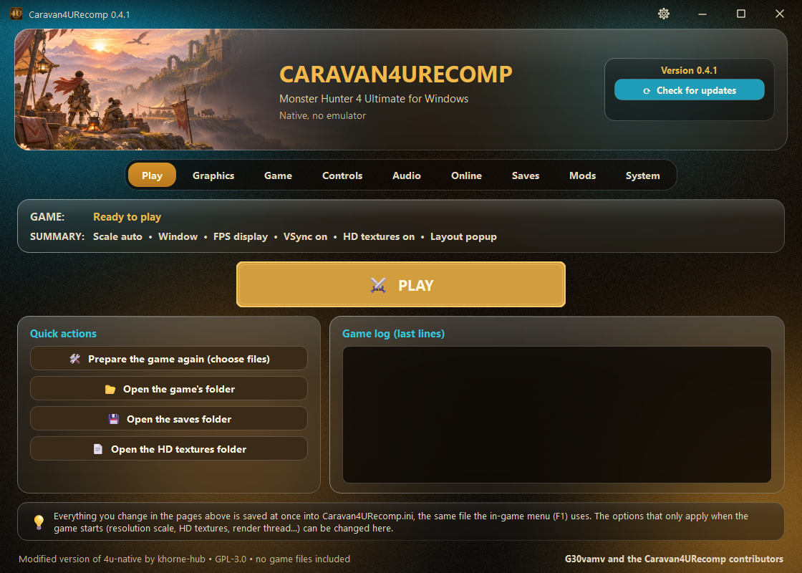
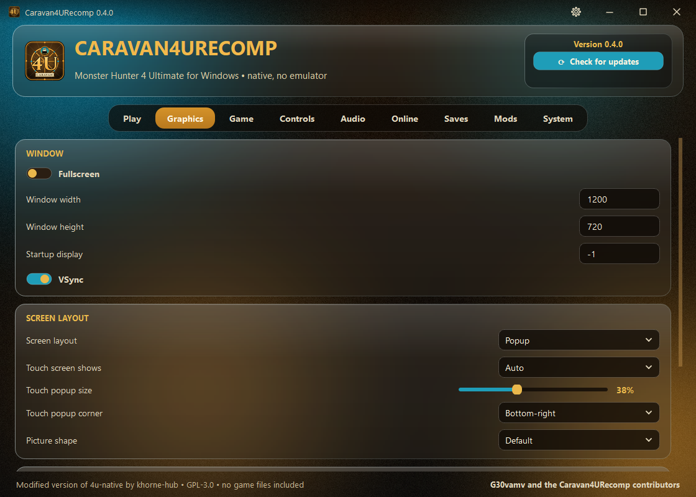
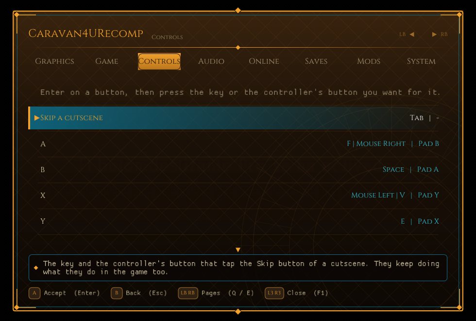

<p align="center"></p>

# Caravan4URecomp

**Monster Hunter 4 Ultimate on Windows, running natively through Vulkan.**

[](https://github.com/G30vamv/Caravan4URecomp/releases)


Caravan4URecomp is my Windows port of [4u-native](https://github.com/khorne-hub/4u-native) by khorne-hub. It is a **modified
version**: it is not the official 4u-native, and it is not made or endorsed by khorne-hub. All the hard work (the
recompiler, the runtime and the original app) is theirs and CompaLarios18's, and I'm very grateful for it. What I added is
a Windows shell around that runtime, a launcher, and my own code for a large part of what the runtime did with code
derived from Azahar.

[Leer en español](#español)

**This project includes no game code, game files, ROMs or keys. You need your own copy of the game.**

<p align="center">
  
  
</p>

## Features

- **Native on Windows, no emulator.** The game's code is recompiled for your PC and drawn with Vulkan, with an internal resolution from 1x to 8x and a frame rate limit of up to 360 fps.
- **A launcher** with every option, a mod manager, your saves and their backups, and updates that download only the files that changed.
- **Your saves, looked after:** automatic backups, a protection for a save cut short while the game writes it, and importing saves from another folder.
- **Play on one screen.** The touch screen's menus can go to the top screen, 16:9 fills the window with no black bars, and the world map opens on the main screen with a key or a button.
- **Keyboard, mouse and controllers.** The mouse is the stylus; DualSense and Xbox-style controllers work, and every button can be changed (the PlayStation touchpad click too). Skipping a cutscene has its own key and button.
- **A better hunt.** A smaller hunting HUD (one size for all and one per part), the life bar of the monster, and optional comforts and cheats (including giving yourself items), all off by default.
- **More graphics options:** antialiasing, bloom, motion blur, depth of field, radial blur, haze, dither and field of view.
- **HD textures** from packs made for Azahar and Citra, with an optional size limit to save video memory.
- **Online** in the same rooms as Azahar and 4u-native for Android.
- **English and Spanish** in the launcher and the in-game menu.

The history of each version is on the [Releases](https://github.com/G30vamv/Caravan4URecomp/releases) page.

## Status

I'd rather be upfront about what I have actually tested.

**Working (tested on Windows 11, NVIDIA RTX 4070, mostly with the USA version v1.3.0):**
- The game boots and runs; character creation, quests and complete hunts, without crashes. In the village with HD textures at 6x it runs at about 90 to 115 fps; in cutscenes it reaches my display's 165.
- Keyboard, mouse (as the stylus of the touch screen) and controller, including a DualSense over Bluetooth and typing a hunter's name with a controller.
- Windowed and fullscreen (F11 or Alt+Enter), resizing, and an internal resolution of 1x to 8x.
- The skip button for the cutscene of eating and the one after killing a monster, with Tab, Start, Back or the PlayStation touchpad.
- The one-screen arrangement, 16:9, and the world map on the main screen (opened with M, Start, Back or the touchpad, with Solo / multiplayer on Y or N).
- The in-game menu and the launcher: I checked each page, changed options and saw them applied.
- Network rooms that speak the same protocol as Azahar's: I joined a real public room from the menu while the game was running, and I played Local Play in a Gathering Hall with another player.
- Saves backups, mods listed, turned on and off and ordered from the launcher, and Discord Rich Presence on a real Discord.
- Starting with no previous save: I created a hunter and a Palico, saved, reopened the game and loaded it. (Up to 0.5.0 the game closed at start in that case.)
- A save cut short: I stopped the real game right after it emptied the save file, and the next start put the last finished save back.
- Importing saves from a folder through the in-game menu, and the offer to use a save that is in the wrong place.
- Infinite items in real hunts, and giving items to the item box and to the pouch.

**Not tested yet:**
- The **update button of the launcher** in its window. The update itself (checking, downloading, checking each file and applying) was tested against real releases, without the button and the automatic restart.
- The vote to end the wait after a quest online: it needs two players with this version.
- Importing saves exported by Azahar, Citra, JKSM or Checkpoint themselves, and the Windows folder dialog used to choose them (I tested the import with copies of my own save files).
- A real power cut while saving (I tested it by stopping the program).
- In a hunt: the damage meter, the damage multiplier, the latest changes to invincibility, the size and position of the monster's life bar, and ammunition given to yourself going straight to the gunner's pouch.
- The launcher flickering when the game closes is fixed in the code, but I haven't checked it on screen.
- The launcher on other PCs and on Windows 10, and with other languages than English and Spanish.
- My own controller reader with real controllers (a DualSense and a GameSir work through the usual path), and the HidHide offer.
- What the game's CPU thread costs in the village: the game runs at about 100 to 115 fps there whatever the resolution, and I plan to look into it.
- The skip button in cutscenes other than the two above, and the mouse as the camera (**F3**, or `mouse_camera = on`).
- Resolutions of 9x and 10x: the picture still comes out black there.
- Other GPUs and drivers, building with MSVC (I build with clang from llvm-mingw), and Windows and Android crossplay.
- A few moments still stutter a little (the roar of some monsters, and very high frame-rate limits); there is an optional, experimental setting for the stutters while shaders are prepared.

## Getting it

The releases are on the [Releases](https://github.com/G30vamv/Caravan4URecomp/releases) page; the latest is **0.6.0**, tagged `windows-v0.6.0`. This port has its
own version numbers, following [semantic versioning](https://semver.org) (while the number starts with 0, anything can still
change), and they are tagged `windows-vX.Y.Z` so they don't mix with the older tags in this repository (`v0.1.0` to `v1.0`),
which are 4u-native's own. Each download has its SHA-256 next to it. The program is not code-signed, so Windows may show a
SmartScreen warning: "More info", then "Run anyway". You can also build it yourself (see [Building](#building)).

**Updating from 0.5.0:** close every copy of the game first. You can use the launcher's update, or unzip the new version over
your folder: the download has no settings file, so yours is kept, and your `game` folder is not touched. You don't need to
build the game's code library again.

## What you need

- Windows 10 or 11, 64-bit, and a GPU with Vulkan 1.2 or newer.
- About 1 GB of free space while the game is prepared (afterwards it takes about 350 MB: the game's code library and the part of the compiler that was downloaded).
- **Your own decrypted copy of Monster Hunter 4 Ultimate (USA):** the base game and the **v1.3.0 update**.

## First start

Unzip everything in a folder you can write to, and open `Caravan4URecomp-Launcher.exe` (or `Caravan4URecomp.exe` directly:
it works the same). The first time you press Play, the game asks for the two game files and builds the game's code library for
your PC, which takes a few minutes and downloads only the part of a compiler that it needs (about 50 MB; each file is checked
against its SHA-256). After that the game starts straight away. `--setup` (or the button in the launcher) repeats this step if
you change files. What it builds is made from your game: keep it for yourself and don't share it.

## The launcher

`Caravan4URecomp-Launcher.exe` sits next to the program and edits `Caravan4URecomp.ini`, the same file the in-game menu uses.
Everything is saved as soon as you change it.

- **Play:** a summary of your settings, the Play button, quick actions and the last lines of the game's log.
- **Graphics, Game, Controls, Audio, Online, Saves, System:** every option of the in-game menu, and the ones that only apply
  when the game starts (the game is closed while the launcher is open, so it can always change them). Hover an option for
  its explanation.
- **Mods:** add a mod as a `.zip` or a folder, turn mods on and off, change their order and remove them. A mod that changes the
  game's files works; a mod that changes its code is installed turned off, because the game's library is built without it.
- **Saves:** opens your saves, your guild cards and quests, and the automatic backups (importing saves is in the in-game menu).
- **Updates:** it looks for a new version when it opens (you can turn that off in the gear menu) and, if you accept, downloads
  only the files that changed, checks each one against its SHA-256, replaces them and opens again. Your settings, your saves
  and your game folder are never touched, and the files it replaces are kept in a backup folder next to the program.
- The gear menu has the launcher's own options: its language (English or Spanish), animations, the Acrylic effect of Windows 11
  and whether it minimizes while you play.

<p align="center"></p>

The launcher is Python (PySide6) code adapted from the launcher of my MH3U port, in this project's colours. You can build it with
`windows\launcher\build_launcher.ps1` (it needs Python with PySide6-Essentials, Pillow and PyInstaller).

## Controls

Keyboard: F = A, Space = B, V = X, E = Y, Enter = Start, Backspace = Select, arrows = D-pad, W A S D = left stick,
O L K ; = right stick, Q = ZL, C = ZR, left Ctrl = L, left Shift = R, Tab = skip a cutscene. The mouse is the stylus on
the bottom screen. A controller works as it is. Every button can be changed in the launcher or in the in-game menu.

### In-game menu

Press **F1** or **L3 + R3** on a controller. It works with the keyboard, the mouse (click, drag the sliders, wheel,
right click to go back) and the controller (D-pad or left stick, A and B; LB and RB, or Q and E, change the page). The
design comes from the menu of my MH3U port, with this game's colours, in the Cinzel font (SIL Open Font License).

<p align="center">
  
  
</p>

- **Graphics:** fullscreen, VSync, screen layout, widescreen, internal resolution (auto, or 1x to 8x the 3DS's; needs a restart), the game's own graphics effects, field of view, HD texture limit, FPS counter.
- **Game:** frame rate limit (the game's own, your display's rate, 30, 60, 120, 180, 240, 300, 360 or unlimited) and particle effects.
- **Audio:** volume.
- **Controls:** the key and the controller's button that skip a cutscene, and every 3DS button with its key and its controller button. Press Enter on one, then the key or the controller's button or trigger you want (Backspace puts it back). The sticks and F1, F2, F3 and F11 stay as they are.
- **Saves:** backups of your saves, made by hand or automatically each time the game starts if the saves changed (the newest 5 automatic ones are kept). Enter twice on a backup puts it back the next time the game starts, after a backup of what was there. You can also import saves from a folder and open your saves' folders (see [Your saves](#your-saves)).
- **Mods:** the built-in mods, comforts and cheats, and your own mods: drop a mod's folder or .zip on the window to install it, turn mods on and off and set their order (they apply the next time the game starts). Mods that change the game's files work; mods that change its code are installed turned off, because the game's library is built without them.
- **System:** the language of the menu (English or Spanish; "auto" follows Windows), resume and quit.
- **Online:** nickname, host a room, join with the copied address, public rooms, join by address, leave.

The default screen layout is the **popup** one: the top screen fills the window and the touch screen appears over it, only when
the game is waiting for you there; **F2** shows or hides it by hand, and the menu lets you choose when it shows (auto, always,
hidden), its size and its corner. The other layouts are **stacked**, **overlay** (the touch screen always over the picture),
**single**, **side** and **large** (a big top screen with a small touch screen at its right). Every change is saved to
`Caravan4URecomp.ini` as soon as you make it. A few settings (the internal resolution, HD textures, the render thread and going
back to "default" in the game options) only apply the next time the game starts: the menu saves them, says so, and lists them
until you close the game; it never restarts anything by itself. **Graphics > Open the HD textures folder** opens the folder for
texture packs.

## Your saves

Your saves are in `game\user\sdmc\Nintendo 3DS\000...\000...\` (the zeros stand for the console and the SD card; it is
the same layout Azahar and Citra use). The buttons in the launcher and in the menu open the right folder, so you don't have to
walk through it.

- Hunter saves: `title\00040000\00126300\data\00000001` (`user1`, `user2`, `user3` and `system`).
- Guild cards, quests and Palicoes: `extdata\00000000\00001263\user`.

**Importing:** in the menu, **Saves > Import saves from a folder**. It looks for the game's save files anywhere inside the folder
you choose and shows what it found. Nothing changes until the next time the game starts, and your current saves are backed up
first. A hunter save needs its `system` file next to it, and it replaces your hunter saves; guild card and quest files replace
the ones with the same name. Only saves of the USA version are accepted. Encrypted files copied straight from a 3DS's SD card
won't work. If you have no hunter save in its place but one is elsewhere inside your `user` folder, the game asks whether to use it.

**Protection:** if the game is cut off while saving, the next start puts back the last save the game finished and keeps what it
took out in `user\.save-discarded`. This covers the hunter save, not the guild cards and quests. Only one game can use a saves
folder at a time.

## Giving yourself items (a cheat)

**Mods > Give items**: search by name or number and choose how many. The **item box** can be filled in a village or the
Gathering Hall, and your **pouch** during a quest. The names are read from your own copy of the game. Your save keeps what you
add, so back it up first.

## Frame rate, resolution and sound

- **Frame rate:** the limit goes up to 360 fps. The counter shows the frames the game really runs (with a 30 fps limit, 30), which
  can be lower than the screen's refresh. With VSync on you can see at most your display's refresh rate, so "display" in the
  limit setting is the natural choice. If it feels uneven at a high refresh rate, lower the internal resolution. Each frame the
  game shows is read back from the GPU, so the highest rate depends on the internal resolution: about 580 fps at 3x, 160 at 6x and
  97 at 8x. In a busy scene (the village with HD textures at 6x on my PC) the game runs at about 90 to 115 fps whatever the limit.
- **Internal resolution (1x to 8x):** everything the GPU draws (the 3D scene, the HUD and the text) is rendered at that multiple
  of the 3DS's resolution; "auto" picks the one closest to your window. The game's own textures stay at their original
  resolution, so edges get sharper but not more detailed. HD texture packs made for Azahar and Citra (PNG, their folder
  layout and hashes) are supported by the runtime: put them under `game\user\load\textures`. At 9x and 10x the picture
  is still black on my card, so the menu stops at 8x.
- **Widescreen:** the 3DS's top screen is 5:3, so on a 16:9 screen there are black bars at the sides. **Graphics > Widescreen**
  draws more of the scene at the sides (it is not stretched): match your window, or 16:9, 16:10 or 21:9. It needs a restart.
- **The HD texture limit (optional):** a texture of an HD pack larger than the limit you choose (4096, 2048, 1024 or 512 pixels on its longer side) is reduced before it is loaded, so it takes less video memory and loads faster, with less detail. With my pack a limit of 1024 cut the textures from 440 to 277 MB. It is off by default.
- **Sound:** the audio buffer is 60 ms by default; `options = --audio-latency 100` in the ini makes it larger if you hear cuts.

## Playing online

The rooms are the same kind Azahar uses, so players on this port, on Azahar and on 4u-native for Android can share a
room. Everyone needs MH4U USA v1.3.0.

1. Open the menu (or the launcher's Online page), and choose a nickname.
2. To **host**: choose **Host a room**. The program looks for a Radmin VPN, Hamachi, ZeroTier or Tailscale address on your PC
   (with one of those there is no router to open) and otherwise for your local network's, and **copies the address with
   its port** (for example `26.1.2.3:24872`) to the clipboard. Send it to your friends. Without a VPN you need the UDP port (24872 by default) open on your router.
3. To **join** a friend: copy the address they sent and choose **Join with the copied address**. Or **Public rooms** lists the
   rooms of the community lobby (a `*` marks the ones set up for MH4U), or type a `HOST:PORT` address by hand. If you write no port, 24872 is used.
4. Being in the room is not enough: in the game, go to the **Gathering Hall** and choose **Local Play**. While you are in a
   room the touch screen stays up in towns (`online_touch = off` in the ini turns that off).

From the command line: `--list-rooms [URL]`, `--join HOST:PORT`, `--host PORT`, `--nick NAME`, `--room-password TEXT`.
The lobby is read over plain HTTP, like Azahar does. Hosted rooms are not announced to the lobby, so people find your room
by its address, not in Azahar's list.

## Building

You need CMake, Ninja, [llvm-mingw](https://github.com/mstorsjo/llvm-mingw) (UCRT, x86_64) and Python 3.10 or newer. In a
PowerShell window:

```
powershell -ExecutionPolicy Bypass -File windows\build.ps1 [-Launcher]
powershell -ExecutionPolicy Bypass -File windows\package.ps1 -Version 0.6.0
```

`build.ps1` downloads SDL3 and builds the program (with `-Launcher` it builds the launcher too); `package.ps1` makes the zip.
The game's code library is built on each player's PC from their own files, and it is never part of this repository.

## What I changed in 4u-native

- New: the `windows/` folder (the Windows shell, the in-game menu, the launcher in `windows/launcher/`, the build and packaging scripts).
- New: `mh4n/native/own/`, my own implementations of services and of the DSP (apt, cfg, ptm, fs, ir, y2r, small services, the DSP core and its service), and in `mh4n/native/src/` the new parts of the kernel, the renderer and the loader that replace code derived from Azahar. The previous implementations stay in the source tree (the tests still use them).
- New: `mh4n/native/src/applets/extrapad.{h,cpp}`, a minimal Extrapad applet so the Circle Pad Pro option in the game's
  settings doesn't close the game.
- Changed: `mh4n/port/src/hooks.cpp` and `hooks.h` (a counter of the objects the game draws on the touch screen, the skip button, the frame counter and the frame limiter's own numbers).
- Changed: `mh4n/native/src/gpu/native/native_gpu.cpp` and the files around it (the renderer uses the Vulkan device the window shell already has, and the
  screen is read out without a one-pixel shift that Azahar's software renderer has and that drew a wrong line along the top
  of the picture).
- Changed: `mh4n/native/src/screen_layout/` (the *large* layout and the fixed overlay) and `mh4n/native/app/audio/`, `mh4n/native/src/audio_out/` (the audio buffer and its diagnostics).
- Changed: `mh4n/port/src/onescreen_table.h` (a generated table, edited by hand: the Gathering Hall's player list stays on
  the touch screen instead of covering the top one), `mh4n/native/src/services/apt/applet_manager.cpp` and `mh4n/native/src/applets/CMakeLists.txt`.

Every changed file says so in its header. The Android app is untouched.

## Credits

- The recompiler and the native runtime: [MH4UltimateDC](https://github.com/CompaLarios18/MH4UltimateDC) by CompaLarios18
  and its contributors.
- 4u-native, the Android app this port is based on: [khorne-hub](https://github.com/khorne-hub/4u-native).
- Parts of the runtime come from [Azahar](https://github.com/azahar-emu/azahar) and Citra.
- The single-screen arrangement of the touch screen's menus is based on [Heavenfall Beta](https://github.com/popzol/4u-heavenfall-mod-beta) by popzol and BlitzWOLF (GPL-3.0), taken at commit `7eebb7a`, without its gameplay changes.
- Some of the comforts follow the ideas of [MH4U-QOL-Cheats](https://github.com/jM5557/MH4U-QOL-Cheats) by jM5557 (I wrote them again for this port).
- The upscaler that was optional until 0.4.3 was AMD's [FidelityFX Super Resolution 1.0](https://github.com/GPUOpen-Effects/FidelityFX-FSR) (MIT license); it is no longer used.
- The libraries used, with their licenses, are listed in `THIRD_PARTY_NOTICES` and `windows/THIRD_PARTY_NOTICES_WINDOWS`.
- The full credits of 4u-native are in its [README](../README.md), which is kept as it was.

## License

Free software under the [GNU General Public License, version 3](../LICENSE) or (at your option) any later version. The code
by khorne-hub carries [additional terms](../ADDITIONAL-TERMS), which still apply: keep the author's credits, mark a changed
version as changed and don't present it as the official one, and give the license and the complete source code with
every copy of the program. New code of this port: Copyright (C) 2026 G30vamv and the Caravan4URecomp contributors. The launcher's
Python code is mine, under the GNU Affero General Public License v3, and it bundles PySide6 (LGPL-3.0), Pillow and PyInstaller
(see `windows/THIRD_PARTY_NOTICES_WINDOWS`).

This project is not affiliated with, endorsed by or sponsored by the Great C or the Great N. Monster Hunter is a trademark
of the Great C. The 3DS is a trademark of the Great N. It contains no game code, game data, ROMs or keys. Use it only with
a copy of the game you own.

---

## Español

**Monster Hunter 4 Ultimate en Windows, nativo y con Vulkan.**

Caravan4URecomp es mi port para Windows de [4u-native](https://github.com/khorne-hub/4u-native), de khorne-hub. Es una
**versión modificada**: no es la oficial ni está hecha ni respaldada por khorne-hub. El trabajo difícil (el recompilador,
el runtime y la app original) es de ellos y de CompaLarios18, y se lo agradezco mucho. Yo añadí un shell para Windows
alrededor de ese runtime, un launcher y código propio para buena parte de lo que el runtime hacía con código derivado de Azahar.

**No incluye el juego.** Necesitas tu propia copia descifrada de Monster Hunter 4 Ultimate (USA) y su update v1.3.0.

**Características:**
- **Nativo en Windows, sin emulador:** el código del juego se recompila para tu PC y se dibuja con Vulkan, con resolución interna de 1x a 8x y límite de fotogramas de hasta 360.
- **Un launcher** con todas las opciones, gestor de mods, tus partidas y sus copias de seguridad, y actualizaciones que bajan solo los archivos que cambian.
- **Tus partidas, más protegidas:** copias automáticas, protección si el guardado se corta a la mitad e importación de partidas desde otra carpeta.
- **Jugar con una sola pantalla:** los menús de la táctil pueden ir a la pantalla de arriba, el 16:9 ocupa toda la ventana sin barras negras, y el mapa del mundo se abre en la pantalla principal con una tecla o un botón.
- **Teclado, ratón y mandos:** el ratón es el lápiz; funcionan DualSense y mandos tipo Xbox, y cada botón se puede cambiar (también el clic del panel táctil de PlayStation). Saltar una cinemática tiene su propia tecla y botón.
- **Una caza mejor:** un HUD de caza más pequeño (un tamaño general y uno por parte), la barra de vida del monstruo y comodidades y trucos opcionales (incluido darte objetos), todo apagado por defecto.
- **Más opciones gráficas:** antialiasing, bloom, desenfoque de movimiento, profundidad de campo, desenfoque radial, neblina, dither y campo de visión.
- **Texturas HD** de packs hechos para Azahar y Citra, con un límite de tamaño opcional para ahorrar memoria de vídeo.
- **Online** en las mismas salas que Azahar y 4u-native para Android.
- **Español e inglés** en el launcher y en el menú del juego.

El historial de cada versión está en la página de [Releases](https://github.com/G30vamv/Caravan4URecomp/releases).

**Estado:** probado en Windows 11 con una RTX 4070: el juego corre, he completado misiones y cacerías, funciona con teclado, ratón y mando (también un DualSense por Bluetooth), entré a una sala pública real de Azahar y jugué Local Play con otra persona. En la aldea con texturas HD a 6x va a unos 90–115 fps. En la 0.6.0 probé además: empezar sin ninguna partida (crear cazador y camarada, guardar y volver a cargar; hasta la 0.5.0 el juego se cerraba al abrir en ese caso), recuperar un guardado cortado, importar partidas desde una carpeta y, en cacerías reales, los objetos infinitos y darse objetos. **Sin probar todavía:** el botón de actualizar del launcher en su ventana (la actualización en sí sí la probé contra releases reales), importar partidas exportadas por Azahar, Citra, JKSM o Checkpoint y el diálogo de carpeta de Windows, un apagón real mientras guarda, en caza el contador y el multiplicador de daño, los últimos cambios de invencible, el tamaño y la posición de la barra del monstruo y que la munición dada vaya directa a la bolsa de artillero, el voto para terminar la espera en línea, el launcher en otros PC y en Windows 10, 9x y 10x (siguen en negro), otras GPU y MSVC. Algunos momentos aún se entrecortan un poco (el rugido de algunos monstruos y los límites de fps muy altos). El parpadeo del launcher al cerrarse el juego está corregido en el código, pero no lo he comprobado en pantalla.

**Tus partidas:** en el menú del juego, **Partidas → Importar partidas de una carpeta** busca los archivos de guardado en la carpeta que elijas, te muestra lo que encuentra y lo aplica al volver a abrir el juego, tras una copia de las tuyas. Una partida de cazador necesita su archivo `system` al lado y reemplaza tus cazadores; las tarjetas y misiones reemplazan las del mismo nombre. Solo se aceptan partidas de la versión USA. Los botones del menú y del launcher abren directamente la carpeta de tus partidas y la de tarjetas y misiones. Si el juego se corta mientras guarda, al volver a abrir se recupera el último guardado terminado. **Mods → Dar objetos** (truco) te pone objetos en el baúl (en una aldea) o en la bolsa (en una misión).

**Para actualizar desde la 0.5.0:** cierra antes todas las copias del juego. Sirve el botón del launcher o descomprimir la versión nueva encima de tu carpeta: la descarga no trae archivo de ajustes, así que conservas el tuyo, y tu carpeta `game` no se toca. No hace falta volver a construir la librería del juego.

**Cómo se usa:** la última versión es la 0.6.0, en la página de Releases (con su suma SHA-256). Descomprime todo en una carpeta y abre `Caravan4URecomp-Launcher.exe` (o `Caravan4URecomp.exe` directamente). La primera vez que pulses Jugar te pide los dos archivos del juego y construye la librería de código para tu PC. El menú del juego se abre con **F1** o **L3 + R3**. Online usa las mismas salas que Azahar: menú → Online → **Alojar una sala** (copia al portapapeles la dirección con puerto de tu Radmin VPN, Hamachi, ZeroTier o Tailscale, o de tu red local, para mandarla a tus amigos) o **Unirse con la dirección copiada**, salas públicas (el * marca las de MH4U) o una dirección `HOST:PORT`; y luego, en el juego, Gathering Hall → Local Play.

Para compilarlo: `windows\build.ps1 [-Launcher]` y `windows\package.ps1 -Version 0.6.0` (CMake, Ninja, llvm-mingw y Python). Los créditos y la licencia
están arriba; los términos adicionales de khorne-hub siguen aplicando.
